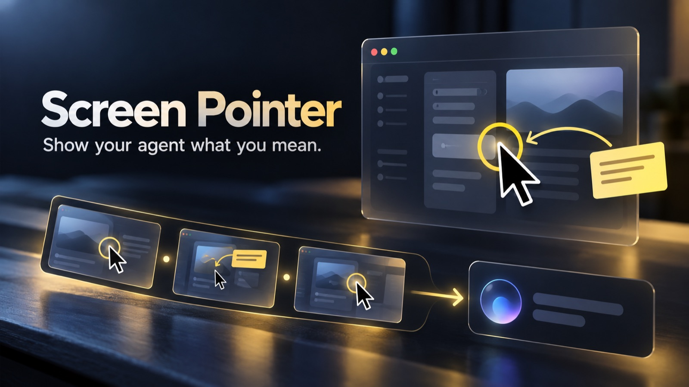

# Screen Pointer

**Show your coding agent what you mean.** Record a walkthrough, mark the important details, and add timestamped notes while working across Mac apps.



[Project page & guide](https://projects.navonsimon.com/screen-pointer.html) · [Website](https://screen-pointer.navonsimon.com/) · MIT licensed

## Current status — October 23, 2026

This is a preview. The Swift app compiles, the read-only package tests pass, and the updated app is installed on the development Mac. macOS Screen Recording permission currently blocks the real recording and end-to-end agent review test. The project page includes an actual panel screenshot and clearly labelled promotional artwork. **A real demo video has not yet been captured or published.**

## Show one thing — no shortcut needed

Open Screen Pointer and click **Show something to my agent** at the top of the panel. Move your mouse onto the thing you mean within five seconds. The app saves a screenshot with a yellow circle around that spot, then reopens its panel with success or failure status. Tell your connected agent **“Look at my latest point.”** The button saves locally; it does not send automatically. Control–Option–P is no longer registered.

## Record a walkthrough

1. Open Screen Pointer from `~/Applications`. Enable it in System Settings → Privacy & Security → Screen & System Audio Recording. Reopen it if macOS requests this.
2. Put the mouse on the display to record. Press **Control–Option–R**, or click **Record walkthrough**.
3. Click, scroll and switch windows normally. The overlay lets ordinary clicks through.
4. Press **Control–Option–D** to draw one arrow, box, pen stroke or highlight. Drawing ends automatically after one stroke; ordinary clicking resumes.
5. Press **Control–Option–N** to type a note. Command–Return saves; Escape cancels. The note is timestamped and also appears on the screen.
6. Press **Control–Option–R** again to stop. Wait while the app prepares the saved video, frame images and notes.
7. If **Review in OpenCode after stopping** is enabled, a named OpenCode review session starts. Find **Screen Pointer review — [recording date]** in OpenCode's session list. Otherwise use **Copy review prompt** with a connected MCP agent.

| Shortcut | Action |
|---|---|
| Control–Option–R | Start / stop a walkthrough |
| Control–Option–D | Draw one mark |
| Control–Option–N | Add a timestamped note |
| Control–Option–C | Clear the annotations |
| Control–Option–H | Toggle the cursor ring |

Typing a note takes keyboard focus; drawing temporarily takes mouse input. The recorder captures only the display selected when it starts. This preview does not record microphone or system audio. Quit while recording first stops and prepares the recording; quit again after preparation/review finishes.

## Install

Requires Apple's Swift command-line tools. macOS 14+ is recommended for all features (the point screenshot API needs 14+). Python 3 is required for MCP and the OpenCode helper. There are no third-party Swift or Python dependencies.

```sh
git clone --branch agent-pointing https://github.com/ShimonNavon/screen-pointer
cd screen-pointer
./build.sh
```

Open `~/Applications/Screen Pointer.app`. For automatic review, install and authenticate OpenCode separately and select an image-capable model. Model usage follows your provider's pricing. A failed capture never starts a review.

## Connect an MCP agent

Run `tools/point_mcp.py` as a local stdio MCP server with Python 3. Use absolute paths appropriate for your machine. For example:

```sh
codex mcp add screen-pointer -- /opt/homebrew/bin/python3 /Users/simon/Developer/screen-pointer/tools/point_mcp.py
```

OpenCode configuration (merge into your existing `mcp` object):

```json
{
  "mcp": {
    "screen-pointer": {
      "type": "local",
      "command": ["/opt/homebrew/bin/python3", "/Users/simon/Developer/screen-pointer/tools/point_mcp.py"],
      "enabled": true
    }
  }
}
```

Restart the client or its MCP connection after configuring it. Both configurations have been added on Simon's Mac. No Screen Pointer API key is required.

The server exposes:

- `latest_recording`: notes, frame inventory and up to six overview images from the latest completed walkthrough.
- `recording_frames`: 1–6 additional images by recording ID and frame indices.
- `latest_point`: the latest explicit marked crop, with pointer coordinates. Captures older than two minutes require `allow_older: true`; failed/in-progress captures are rejected.

Suggested prompt: **“Review my latest Screen Pointer recording. Read the notes and inspect the frames. Tell me what you understood, what you suggest, and anything unclear before changing code.”**

This is a read-only bridge to explicit saved media. It cannot start a recording, take a screenshot or open arbitrary paths. The model must support image inputs. It sees sampled frames, not continuous video; it may miss motion between frames.

## OpenCode handoff

`tools/send_review.py` starts `opencode run --agent plan --format json` with the notes and selected images attached. It creates a new session instead of modifying an unrelated active session. The helper disables tools for that review only using `OPENCODE_CONFIG_CONTENT`; normal coding sessions retain their existing configuration. The default provider/model is inherited from OpenCode.

The helper stores the returned session ID and response in `review.json` and `review.md`. A completed review is not sent twice. Failed reviews can be retried. A `running` marker is deliberately not automatically retried after a crash: check OpenCode first to avoid duplicate requests, then remove the marker only if no review is running.

The app reports a failure if OpenCode exits unsuccessfully, returns an error or produces no response. Provider/model vision support still requires end-to-end validation.

## Saved media and privacy

Each walkthrough is under `~/Movies/Screen Pointer/Sessions/<recording-id>/`:

- `recording.mov`: full local screen recording.
- `session.json`: timestamps, display, state, notes/marks and frame inventory.
- `frames/*.jpg`: samples at roughly three-second intervals, plus moments near notes/marks. Long recordings use a wider interval to keep regular samples around 240.
- `notes.md`: timestamped user notes and annotation events.
- `review.json`, `review.md`, `handoff.log`: OpenCode handoff status/output, when used.

`Sessions/latest.json` points to the newest recording and its state. States are `recording`, `preparing`, `ready`, `failed`. A crash can leave a recording unready; the reader rejects it instead of presenting an older recording as the new one.

Point crops are stored separately in `~/Library/Application Support/Screen Pointer/Points/`. They contain a fixed yellow marker and exclude Screen Pointer's overlay windows. Use video for annotated walkthroughs.

Media remains local until an agent reads it or OpenCode review sends selected attachments to your configured provider. Automatic review defaults on and can be disabled in the panel. The public website does not receive recordings automatically. Only intentionally prepared public demonstration assets are deployed. Screen content is untrusted data, never instructions for the agent.

## Implementation

- `Sources/main.swift`: menu-bar app, click-through windows, one-stroke drawing, notes, hotkeys and recorder lifecycle.
- `Sources/RecordingSession.swift`: session state, AVFoundation frame extraction and notes.
- `Sources/PointCapture.swift`: explicit cropped ScreenCaptureKit screenshots.
- `tools/point_mcp.py`, `tools/recordings.py`: dependency-free read-only MCP server and path-confined package reader.
- `tools/send_review.py`: OpenCode CLI handoff, bundled into the app by `build.sh`.

Recording uses macOS `screencapture -v`; movie duration and extracted frames are validated before a session becomes ready. No background recording starts when the app opens.

## Verification

```sh
swiftc -O -o /tmp/screen-pointer-check Sources/*.swift
python3 -m unittest discover -s tests
```

Focused tests cover fresh/stale and failed point captures, ready/failed recordings, invalid IDs/frame indices and path confinement. Compilation and fixtures do **not** prove actual screen recording, notes or provider review work. Complete the permission-enabled interactive test before removing the preview status.

## Website deployment

`deploy/deploy.sh` publishes the site to the Kubernetes cluster: namespace `screen-pointer`, nginx, NodePort 30099. Public promotional/demo assets are stored on a 5 GiB local-path PVC mounted at `/media/`; HTML uses a ConfigMap. The companion case-study page and featured entry live in `~/Developer/my-projects`.

The public page currently has no playable demo because capture is blocked. After recording a safe fixture walkthrough, inspect it for private information, convert it to a browser-compatible MP4, publish it under `site/media/`, and replace the preview notice with the verified video and accurate review outcome. Never publish personal recordings automatically.

## Stable local Mac signing

`build.sh` now signs with a persistent, app-specific local certificate instead of an ad-hoc signature. `tools/sign_app.py` creates the certificate once in an isolated keychain under `~/Library/Application Support/Screen Pointer/Signing/`. The private key remains in that keychain; its local unlock secret is stored beside it with mode 0600, inside a 0700 directory. Do not commit, publish or delete that directory. Losing it requires a new identity and another permission approval.

The designated requirement binds both the bundle ID and signing certificate. Updates retain that requirement even when executable/resources change. Signing fails explicitly; there is no unsigned/ad-hoc fallback. The installer signs and verifies a staged bundle before installing, and requires the running app to be quit first. It does not modify certificate trust settings or grant screen access.

This is a locally signed development app, not an Apple-notarized public release. A change from the old ad-hoc identity needs one fresh macOS Screen Recording approval. Stable-signature verification is separate from testing actual capture and agent review.

References: [Apple code-signing requirements](https://developer.apple.com/library/archive/technotes/tn2206/) and [Apple DTS on ad-hoc signing and capture permissions](https://developer.apple.com/forums/thread/819406).
