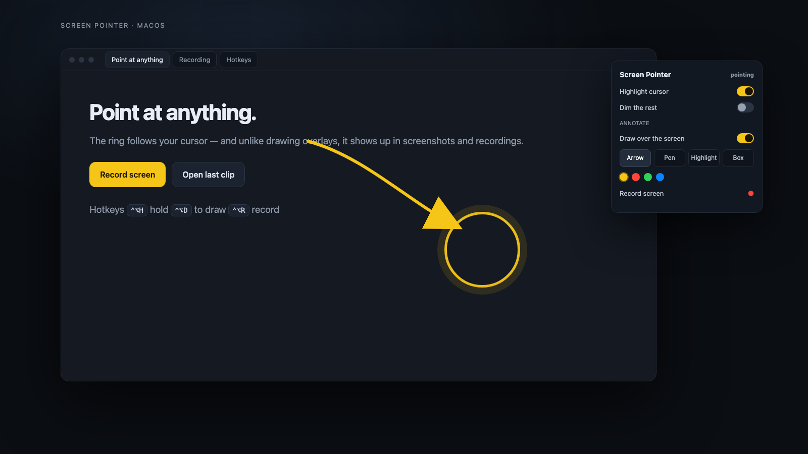

<div align="center">



# Screen Pointer

**A ring around your cursor that actually shows up in screenshots and recordings.**

[](#install)
[](Sources/main.swift)
[](#how-it-is-built)
[](LICENSE)
[](https://screen-pointer.navonsimon.com/)

[Website](https://screen-pointer.navonsimon.com/) · [Install](#install) · [Hotkeys](#hotkeys) · [Why](#why)

</div>

---

## Why

Every screen-drawing app (Annotate, ScreenBrush, Skitch) is built to stay **out** of screen capture. That is the
right default for a call — and exactly wrong when the person you are pointing at is an agent looking at a
screenshot.

Screen Pointer is a normal window at floating level. The ring on your cursor, the arrows you draw and the notes you
pin are all in the picture. It also never takes keyboard focus, so you can keep typing while you point.

## Point something out to your coding agent

The ring alone does not communicate with an agent. Use the explicit capture workflow:

1. Open Screen Pointer. You can leave **Highlight cursor** and **Draw over the screen** off.
2. Put your mouse over the thing you mean and press **Control–Option–P**. Alternatively, choose **Capture in 3 seconds**, then move the mouse to the target.
3. Ask your agent: **“Look at my latest point and tell me what I’m pointing at.”**
4. After the agent identifies it, describe the change you want. **Copy agent prompt** prepares a message with the tool name and local image fallback; it does not send a message automatically.

A screenshot of up to 960 × 640 display points is saved locally with a fixed yellow marker. It uses the display containing the pointer and records top-left image coordinates, timestamp and foreground application. The moving ring and Screen Pointer panel are excluded. Existing drawn annotations are also excluded from this cropped agent capture; use recordings for annotated walkthroughs.

Captures require **macOS 14+** and Screen Recording permission for Screen Pointer under System Settings → Privacy & Security → Screen & System Audio Recording. There is no always-on screen stream, network listener or background capture. Images remain in `~/Library/Application Support/Screen Pointer/Points/` until you remove them. When an agent reads one, the image becomes part of that agent’s conversation and follows that provider’s data handling.

### Agent connection

`tools/point_mcp.py` is a dependency-free Python 3 MCP stdio server. It exposes one read-only tool, `latest_point`, returning the marked PNG plus context. It cannot take screenshots or read arbitrary paths. Failed/in-progress captures are rejected. Captures older than two minutes require the explicit `allow_older` option.

Codex setup (configured on Simon’s Mac):

```sh
codex mcp add screen-pointer -- /opt/homebrew/bin/python3 /Users/simon/Developer/screen-pointer/tools/point_mcp.py
```

Restart the MCP connection/client if it was already running when added. Other MCP-compatible coding agents can run the same Python command. No API key is required. Until the MCP tool is available, the copied prompt includes the saved PNG path for agents with local image-reading tools.

## What it does

| | |
| --- | --- |
| 🎯 **Highlight** | A warm ring follows the cursor on every display and every Space. |
| ✏️ **Annotate** | Hand the mouse to the overlay and draw arrows, freehand, highlighter or boxes in four colours. |
| ⏺ **Record** | One hotkey starts and stops a clip; the ring and the drawings are in it. |
| 🌘 **Spotlight** | Optionally dim everything except a circle around the pointer. |
| 🧠 **Stays out of the way** | Clicks pass through, it is never in Mission Control, and it does not steal focus. |

## Hotkeys

| Shortcut | Action |
| --- | --- |
| <kbd>⌃</kbd><kbd>⌥</kbd><kbd>H</kbd> | Highlight the cursor |
| <kbd>⌃</kbd><kbd>⌥</kbd><kbd>D</kbd> | Draw over the screen |
| <kbd>⌃</kbd><kbd>⌥</kbd><kbd>R</kbd> | Start / stop recording |

Everything else lives in the menu-bar panel: tool, colour, width, Undo, Clear, recorder timer, and the last clip.

## Install

```bash
git clone https://github.com/ShimonNavon/screen-pointer
cd screen-pointer
./build.sh                     # compiles and installs ~/Applications/Screen Pointer.app
open "$HOME/Applications/Screen Pointer.app"
```

Requirements: macOS 13+, Xcode command-line tools. The first recording asks for Screen Recording permission; the
highlight needs none.

## Recordings

Clips land in `~/Movies/Screen Pointer/Screen <date> <time>.mov`, with the newest path in `last-recording.txt` beside
them so a script (or an agent) can pick it up without guessing. There is no length limit — roughly 1 GB per hour at
1080p. For anyone who reads images rather than video:

```bash
ffmpeg -i "$(cat ~/Movies/'Screen Pointer'/last-recording.txt)" -vf fps=1 /tmp/frames/f%02d.png
```

## How it is built

One Swift file, `Sources/main.swift`, no dependencies.

- A borderless, non-activating `NSWindow` per screen at `.floating` level with `ignoresMouseEvents`, so clicks reach
  whatever is underneath until draw mode is on.
- `collectionBehavior = [.canJoinAllSpaces, .fullScreenAuxiliary, .stationary]` keeps the ring with you across Spaces.
- A 60 Hz timer redraws the ring and any in-progress shape at `NSEvent.mouseLocation`.
- Carbon `RegisterEventHotKey` for the three global hotkeys.
- Recording shells out to `/usr/sbin/screencapture -v`, which writes QuickTime directly — no AVFoundation plumbing.

Two things that bit us, kept as guard rails in the code:

- `.statusBar` level outranks system UI; `.floating` is the right level.
- `.transient` excludes a window from Mission Control **and** hides it on the active Space. Not what you want here.

## Limits

- macOS only. The Windows/Linux equivalent is a different program.
- The overlay is one bitmap per screen; very large annotation sets are not designed for.
- Global hotkeys are fixed (⌃⌥H / ⌃⌥D / ⌃⌥R); there is no rebinding UI yet.

## License

MIT.

## Focused checks

`swiftc -O -o /tmp/screen-pointer-check Sources/*.swift` checks the native build. `python3 -m unittest discover -s tests` checks capture freshness, failed captures, image delivery and path confinement. The app must also be tested interactively with Screen Recording permission; compilation alone does not prove screen capture works.
